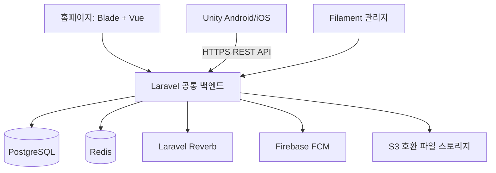
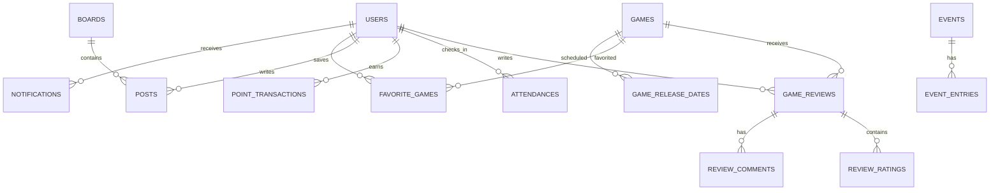
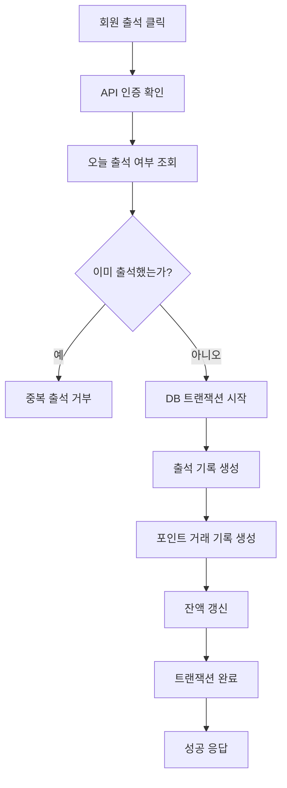

# 게임평가단 통합 기술 개발 설계서

> 작성 기준: 2026-11-19  
> 목적: 게임평가단 홈페이지, 관리자, Unity 모바일 앱이 하나의 Laravel 백엔드와 PostgreSQL 데이터베이스를 공유하는 통합 플랫폼 구축

## 1. 프로젝트 개요

게임평가단은 게임 정보, 출시 일정, 이용자 평가와 리뷰, 커뮤니티, 출석, 포인트, 랭킹, 이벤트를 제공하는 통합 게임 커뮤니티 플랫폼이다.

### 확정 기술 구성

| 영역 | 기술 | 역할 |
|---|---|---|
| 홈페이지 | Laravel Blade + Vue | 사용자 웹사이트 |
| 백엔드 | Laravel | 비즈니스 로직, 인증, API |
| 관리자 | Filament | 운영자 관리 화면 |
| 데이터베이스 | PostgreSQL | 웹·앱·관리자 공통 데이터 |
| 모바일 앱 | Unity C# | Android/iOS 앱 |
| 인증 | Laravel Sanctum | 웹 세션 및 모바일 API 토큰 |
| 캐시·작업 | Redis | 캐시, 대기열, 반복 작업 |
| 실시간 기능 | Laravel Reverb | 웹소켓 기반 실시간 알림 |
| 푸시 알림 | Firebase Cloud Messaging | 모바일 푸시 |
| 파일 | S3 호환 스토리지 | 이미지 및 첨부파일 |

### 핵심 아키텍처 원칙

- 홈페이지, Unity 앱, Filament 관리자는 동일한 Laravel 백엔드를 사용한다.
- 모든 서비스 데이터는 하나의 PostgreSQL 원본 데이터베이스에 저장한다.
- 모바일 앱은 데이터베이스에 직접 접속하지 않고 HTTPS API만 사용한다.
- 웹과 앱은 인증 방식이 다를 수 있지만 동일한 회원 계정과 권한 체계를 사용한다.
- 비즈니스 로직은 컨트롤러에 중복 작성하지 않고 서비스 계층에서 공유한다.



## 2. Laravel 프로젝트 폴더 구조

프로젝트 이름은 `game-evaluation`으로 가정한다. 초기에는 웹·API·관리자 기능을 하나의 Laravel 프로젝트에 두고, 모듈별로 분리한다.

```text
game-evaluation/
├── app/
│   ├── Enums/
│   │   ├── UserRole.php
│   │   ├── ReviewStatus.php
│   │   └── PointType.php
│   ├── Filament/
│   │   └── Resources/
│   │       ├── Users/
│   │       ├── Games/
│   │       ├── Reviews/
│   │       ├── Posts/
│   │       ├── Events/
│   │       └── PointPolicies/
│   ├── Http/
│   │   ├── Controllers/
│   │   │   ├── Web/
│   │   │   └── Api/V1/
│   │   │       ├── Auth/
│   │   │       ├── Game/
│   │   │       ├── Review/
│   │   │       ├── Release/
│   │   │       ├── Community/
│   │   │       ├── Attendance/
│   │   │       ├── Point/
│   │   │       └── MyPage/
│   │   ├── Middleware/
│   │   └── Requests/Api/V1/
│   ├── Models/
│   │   ├── User.php
│   │   ├── Game.php
│   │   ├── Genre.php
│   │   ├── Platform.php
│   │   ├── GameReview.php
│   │   ├── ReviewRating.php
│   │   ├── Attendance.php
│   │   ├── PointTransaction.php
│   │   ├── Post.php
│   │   └── Notification.php
│   ├── Policies/
│   ├── Services/
│   │   ├── GameService.php
│   │   ├── ReviewService.php
│   │   ├── AttendanceService.php
│   │   ├── PointService.php
│   │   └── NotificationService.php
│   ├── Events/
│   ├── Jobs/
│   └── Notifications/
├── database/
│   ├── migrations/
│   ├── factories/
│   └── seeders/
├── resources/
│   ├── views/
│   │   ├── layouts/
│   │   ├── home/
│   │   ├── games/
│   │   ├── reviews/
│   │   ├── releases/
│   │   ├── community/
│   │   └── mypage/
│   ├── js/
│   │   ├── app.js
│   │   ├── components/
│   │   ├── pages/
│   │   ├── composables/
│   │   └── api/client.js
│   └── css/app.css
├── routes/
│   ├── web.php
│   ├── api.php
│   ├── channels.php
│   └── console.php
├── storage/
├── tests/
│   ├── Feature/
│   └── Unit/
├── public/
├── .env
├── composer.json
└── package.json
```

### 폴더별 책임

| 영역 | 책임 |
|---|---|
| Controllers | HTTP 요청과 응답 처리 |
| Services | 업무 규칙과 핵심 로직 |
| Models | 데이터베이스 모델 및 관계 |
| Requests | 입력값 검증 |
| Policies | 회원·관리자 권한 검사 |
| Filament | 관리자 화면 |
| Jobs | 이미지 처리, 알림 등 비동기 작업 |
| Events | 리뷰 등록, 출석 완료 등 이벤트 |

컨트롤러는 요청을 받고 서비스를 호출하는 역할에 집중한다. 예를 들어 출석 중복 검사와 포인트 지급은 `AttendanceService` 및 `PointService`가 담당한다.

## 3. 설치 및 개발 환경

### 3.1 권장 환경

| 항목 | 권장 구성 |
|---|---|
| PHP | 8.3 이상 |
| Laravel | 13.x |
| Composer | 최신 안정 버전 |
| Node.js | LTS |
| PostgreSQL | 지원 중인 안정 버전 |
| Redis | 최신 안정 버전 |
| Git | 최신 안정 버전 |
| IDE | VS Code 또는 PhpStorm |

버전과 패키지 호환성은 실제 설치 시 공식 문서에서 다시 확인한다.

### 3.2 Laravel 프로젝트 생성

```bash
composer global require laravel/installer
laravel new game-evaluation
cd game-evaluation
npm install
```

Blade 중심 프로젝트를 만들고 Vue 컴포넌트를 필요한 곳에 삽입하는 방식으로 구성한다. Laravel의 Inertia 기반 Vue 스타터 키트와는 다른 구조이므로 설치 과정에서 프로젝트 요구에 맞는 구성을 선택한다.

### 3.3 Vue 및 Vite 설치

```bash
npm install vue
npm install -D @vitejs/plugin-vue
```

`vite.config.js` 예시:

```javascript
import { defineConfig } from 'vite';
import laravel from 'laravel-vite-plugin';
import vue from '@vitejs/plugin-vue';

export default defineConfig({
    plugins: [
        laravel({
            input: [
                'resources/css/app.css',
                'resources/js/app.js',
            ],
            refresh: true,
        }),
        vue(),
    ],
});
```

`resources/js/app.js` 예시:

```javascript
import { createApp } from 'vue';

import GameRating from './components/GameRating.vue';
import FavoriteButton from './components/FavoriteButton.vue';

document.querySelectorAll('[data-vue-component]').forEach((element) => {
    const components = {
        'game-rating': GameRating,
        'favorite-button': FavoriteButton,
    };

    const component = components[element.dataset.vueComponent];

    if (component) {
        createApp(component, element.dataset.props
            ? JSON.parse(element.dataset.props)
            : {}
        ).mount(element);
    }
});
```

Blade에서 사용하는 예:

```blade
<div
    data-vue-component="game-rating"
    data-props='{"gameId": 15}'
></div>
```

Blade는 페이지 구조와 검색엔진 노출에 활용하고, 별점·관심 게임 등록·리뷰 작성 등 상호작용이 필요한 부분에 Vue를 사용한다.

### 3.4 Filament 설치

```bash
composer require filament/filament:"^5.0"
php artisan filament:install --panels
php artisan make:filament-user
```

관리자 기본 경로는 일반적으로 `/admin`이다. Filament 버전과 Laravel/PHP 요구사항은 설치 시점의 공식 문서를 확인한다.

### 3.5 Sanctum API 인증 설치

```bash
php artisan install:api
```

Unity 앱은 로그인 후 발급받은 Sanctum 토큰을 `Authorization: Bearer` 헤더로 전달한다.

### 3.6 PostgreSQL 데이터베이스 생성

PostgreSQL에서 다음 SQL을 실행한다.

```sql
CREATE DATABASE game_evaluation;

CREATE USER game_user WITH PASSWORD '강력한_비밀번호';

GRANT ALL PRIVILEGES ON DATABASE game_evaluation TO game_user;
```

`.env` 예시:

```env
APP_NAME="게임평가단"
APP_ENV=local
APP_DEBUG=true
APP_URL=http://localhost:8000

DB_CONNECTION=pgsql
DB_HOST=127.0.0.1
DB_PORT=5432
DB_DATABASE=game_evaluation
DB_USERNAME=game_user
DB_PASSWORD=강력한_비밀번호

CACHE_STORE=redis
QUEUE_CONNECTION=redis
SESSION_DRIVER=database
```

PHP의 PostgreSQL PDO 드라이버가 설치되어 있어야 한다. 운영 환경에서는 `APP_DEBUG=false`로 설정하고 비밀번호·키를 안전하게 관리한다.

### 3.7 Reverb 설치

```bash
php artisan install:broadcasting --reverb
php artisan reverb:start
```

실시간 알림이 필요한 화면에서 Reverb를 사용한다. 모든 데이터 조회를 웹소켓으로 처리할 필요는 없다.

### 3.8 최초 실행

```bash
php artisan migrate
npm run dev
php artisan serve
```

개발 중에는 Laravel 서버, Vite, Redis Queue Worker, Reverb를 각각 실행한다. 운영 환경에서는 프로세스 관리 도구 등을 이용해 안정적으로 관리한다.

## 4. 데이터베이스 설계

데이터베이스는 다음 영역으로 나눈다.

1. 회원 및 권한
2. 게임 정보
3. 게임 평가 및 리뷰
4. 출시 일정
5. 커뮤니티
6. 출석 및 포인트
7. 등급 및 랭킹
8. 관심 게임 및 알림
9. 이벤트 및 운영 기록

### 4.1 회원 및 권한

| 테이블 | 주요 컬럼 | 설명 |
|---|---|---|
| users | id, email, password, nickname, status | 회원 기본정보 |
| user_profiles | user_id, profile_image, introduction | 회원 프로필 |
| roles | id, name, slug | 역할 |
| role_user | user_id, role_id | 회원-역할 연결 |
| personal_access_tokens | Sanctum 기본 컬럼 | API 토큰 |
| user_devices | id, user_id, device_token, platform | 푸시 기기 정보 |

회원 상태는 `active`, `suspended`, `withdrawn` 등으로 관리한다.

### 4.2 게임 정보

| 테이블 | 주요 컬럼 | 설명 |
|---|---|---|
| games | id, title, slug, description, developer, publisher, status | 게임 기본정보 |
| genres | id, name, slug | 장르 |
| game_genre | game_id, genre_id | 게임-장르 연결 |
| platforms | id, name, slug | PC, PlayStation, Xbox, Switch, Mobile 등 |
| game_platform | game_id, platform_id | 게임-플랫폼 연결 |
| game_images | id, game_id, image_url, image_type, sort_order | 게임 이미지 |
| game_release_dates | id, game_id, platform_id, release_date, release_status | 출시일 |

게임은 여러 장르와 플랫폼을 가질 수 있으므로 연결 테이블을 사용한다.

### 4.3 게임 평가 및 리뷰

| 테이블 | 주요 컬럼 | 설명 |
|---|---|---|
| game_reviews | id, game_id, user_id, title, content, status | 리뷰 본문 |
| rating_categories | id, name, slug, sort_order, is_active | 평가 항목 |
| review_ratings | id, review_id, rating_category_id, score | 항목별 점수 |
| review_likes | id, review_id, user_id | 리뷰 추천 |
| review_comments | id, review_id, user_id, content | 리뷰 댓글 |
| review_reports | id, review_id, user_id, reason, status | 신고 |

권장 평가 항목은 그래픽, 사운드, 스토리, 조작감, 게임성, 가성비, 종합 평가다. 점수는 1~10점으로 시작할 수 있다.

초기 정책은 회원당 게임별 리뷰 1개를 권장한다. 수정 이력, 비공개 및 승인 상태, 신고 처리 정책을 정의한다. 평균 점수는 공개된 리뷰만 집계한다.

### 4.4 커뮤니티

| 테이블 | 주요 컬럼 | 설명 |
|---|---|---|
| boards | id, name, slug, description | 게시판 |
| posts | id, board_id, user_id, title, content, status | 게시글 |
| post_comments | id, post_id, user_id, content | 댓글 |
| post_likes | id, post_id, user_id | 추천 |
| post_attachments | id, post_id, file_url | 첨부파일 |
| post_reports | id, post_id, user_id, reason | 신고 |

게시판 예: 자유게시판, 게임토론, 공략, 질문답변, 정보공유.

### 4.5 출석 및 포인트

| 테이블 | 주요 컬럼 | 설명 |
|---|---|---|
| attendances | id, user_id, attendance_date, points | 출석 기록 |
| point_transactions | id, user_id, amount, type, reference_id, description | 포인트 원장 |
| point_policies | id, action, points, is_active | 포인트 정책 |

포인트는 잔액만 저장하지 말고 거래 원장을 반드시 남긴다. 포인트 적립·사용은 DB 트랜잭션으로 처리한다. 출석은 `user_id + attendance_date`에 UNIQUE 제약을 둔다.

### 4.6 등급 및 랭킹

| 테이블 | 주요 컬럼 | 설명 |
|---|---|---|
| user_levels | id, name, min_points, icon | 회원 등급 |
| user_level_histories | id, user_id, old_level_id, new_level_id | 등급 변경 이력 |
| ranking_snapshots | id, user_id, ranking_type, score, rank, snapshot_date | 랭킹 집계 |

랭킹은 일정 주기로 집계해 저장하는 방식을 권장한다.

### 4.7 관심 게임 및 알림

| 테이블 | 주요 컬럼 | 설명 |
|---|---|---|
| favorite_games | id, user_id, game_id | 관심 게임 |
| release_alerts | id, user_id, game_id, is_enabled | 출시 알림 설정 |
| notifications | id, user_id, type, title, body, read_at | 알림 |
| notification_logs | id, user_id, channel, status | 발송 기록 |

### 4.8 이벤트 및 운영 기록

| 테이블 | 주요 컬럼 | 설명 |
|---|---|---|
| events | id, title, content, start_at, end_at, status | 이벤트 |
| event_entries | id, event_id, user_id, created_at | 이벤트 참여 |
| announcements | id, title, content, is_published | 공지사항 |
| admin_logs | id, admin_id, action, target_type, target_id | 관리자 작업 로그 |

### 4.9 주요 관계



### 4.10 데이터 무결성 및 인덱스 원칙

| 항목 | 기준 |
|---|---|
| 회원 이메일 | UNIQUE |
| 닉네임 | 서비스 정책에 따라 UNIQUE 권장 |
| 게임 slug | UNIQUE |
| 출석 | user_id + attendance_date UNIQUE |
| 관심 게임 | user_id + game_id UNIQUE |
| 리뷰 추천 | user_id + review_id UNIQUE |
| 리뷰 점수 | 1~10 CHECK 제약 |
| 날짜 | DB에는 UTC 저장, 화면에서 한국 시간 변환 |
| 삭제 | 실제 삭제보다 상태 변경과 보존 우선 |

게임 검색, 출시일, 리뷰의 게임 ID, 게시글의 게시판 ID, 알림의 회원 ID 등에 인덱스를 구성한다.

## 5. API 설계

Unity 앱은 홈페이지 HTML을 직접 가져오는 방식이 아니라 Laravel REST API를 호출한다.

기본 API 주소:

```text
https://api.game-evaluation.com/api/v1/
```

실제 도메인 확정 전에는 개발 주소를 사용한다.

### 5.1 인증 API

| Method | URL | 기능 | 인증 |
|---|---|---|---|
| POST | /auth/register | 회원가입 | 불필요 |
| POST | /auth/login | 로그인 | 불필요 |
| POST | /auth/logout | 로그아웃 | 필요 |
| GET | /auth/me | 내 정보 | 필요 |
| POST | /auth/forgot-password | 재설정 요청 | 불필요 |
| POST | /auth/reset-password | 비밀번호 재설정 | 불필요 |

### 5.2 게임 API

| Method | URL | 기능 |
|---|---|---|
| GET | /games | 게임 목록 |
| GET | /games/{id} | 게임 상세 |
| GET | /games/search | 게임 검색 |
| GET | /genres | 장르 목록 |
| GET | /platforms | 플랫폼 목록 |
| GET | /games/{id}/reviews | 리뷰 목록 |
| GET | /games/{id}/rating-summary | 평가 통계 |

### 5.3 리뷰 API

| Method | URL | 기능 |
|---|---|---|
| POST | /games/{id}/reviews | 리뷰 작성 |
| GET | /reviews/{id} | 리뷰 상세 |
| PUT | /reviews/{id} | 리뷰 수정 |
| DELETE | /reviews/{id} | 리뷰 삭제 또는 비공개 |
| POST | /reviews/{id}/like | 추천 |
| DELETE | /reviews/{id}/like | 추천 취소 |
| POST | /reviews/{id}/comments | 댓글 작성 |
| POST | /reviews/{id}/reports | 신고 |

### 5.4 출시 일정 API

| Method | URL | 기능 |
|---|---|---|
| GET | /releases | 전체 출시 일정 |
| GET | /releases/upcoming | 출시 예정 게임 |
| GET | /games/{id}/releases | 게임별 출시 일정 |
| POST | /games/{id}/release-alerts | 출시 알림 설정 |
| DELETE | /games/{id}/release-alerts | 출시 알림 해제 |

### 5.5 커뮤니티 API

| Method | URL | 기능 |
|---|---|---|
| GET | /boards | 게시판 목록 |
| GET | /boards/{slug}/posts | 게시글 목록 |
| POST | /boards/{slug}/posts | 게시글 작성 |
| GET | /posts/{id} | 게시글 상세 |
| PUT | /posts/{id} | 게시글 수정 |
| DELETE | /posts/{id} | 게시글 삭제 |
| POST | /posts/{id}/comments | 댓글 작성 |
| POST | /posts/{id}/like | 추천 |

### 5.6 출석 및 포인트 API

| Method | URL | 기능 |
|---|---|---|
| GET | /attendance/today | 오늘 출석 여부 |
| POST | /attendance | 출석 처리 |
| GET | /attendance/history | 출석 내역 |
| GET | /points/balance | 잔액 |
| GET | /points/history | 거래 내역 |
| GET | /rankings | 랭킹 |

### 5.7 마이페이지 API

| Method | URL | 기능 |
|---|---|---|
| GET | /mypage | 대시보드 |
| PUT | /mypage/profile | 프로필 수정 |
| GET | /mypage/reviews | 작성 리뷰 |
| GET | /mypage/posts | 작성 게시글 |
| GET | /mypage/favorites | 관심 게임 |
| POST | /games/{id}/favorite | 관심 게임 등록 |
| DELETE | /games/{id}/favorite | 관심 게임 해제 |
| GET | /notifications | 알림 목록 |
| PUT | /notifications/{id}/read | 읽음 처리 |

### 5.8 API 응답 규격

성공 응답:

```json
{
  "success": true,
  "message": "게임 목록을 불러왔습니다.",
  "data": {
    "items": [],
    "pagination": {
      "current_page": 1,
      "last_page": 10,
      "per_page": 20,
      "total": 200
    }
  }
}
```

실패 응답:

```json
{
  "success": false,
  "message": "이미 오늘 출석을 완료했습니다.",
  "errors": {}
}
```

모든 API는 응답 규격과 오류 코드, 페이지네이션, 날짜 형식, 점수 형식을 일관되게 유지한다.

### 5.9 Laravel API 라우트 예시

`routes/api.php`:

```php
<?php

use Illuminate\Support\Facades\Route;
use App\Http\Controllers\Api\V1\Auth\AuthController;
use App\Http\Controllers\Api\V1\Game\GameController;
use App\Http\Controllers\Api\V1\Review\ReviewController;
use App\Http\Controllers\Api\V1\Attendance\AttendanceController;

Route::prefix('v1')->group(function () {
    Route::prefix('auth')->group(function () {
        Route::post('/register', [AuthController::class, 'register']);
        Route::post('/login', [AuthController::class, 'login']);
    });

    Route::get('/games', [GameController::class, 'index']);
    Route::get('/games/{game}', [GameController::class, 'show']);

    Route::middleware('auth:sanctum')->group(function () {
        Route::post('/auth/logout', [AuthController::class, 'logout']);
        Route::get('/auth/me', [AuthController::class, 'me']);

        Route::post(
            '/games/{game}/reviews',
            [ReviewController::class, 'store']
        );

        Route::get(
            '/attendance/today',
            [AttendanceController::class, 'today']
        );

        Route::post(
            '/attendance',
            [AttendanceController::class, 'store']
        );
    });
});
```

실제 컨트롤러에서는 FormRequest로 입력을 검증하고 Service로 업무 로직을 처리하며 API Resource로 응답 형식을 통일한다.

### 5.10 Unity 로그인 예시

요청:

```http
POST /api/v1/auth/login
Content-Type: application/json
Accept: application/json
```

```json
{
  "email": "user@example.com",
  "password": "user-password",
  "device_name": "Unity Android"
}
```

응답 예:

```json
{
  "success": true,
  "message": "로그인되었습니다.",
  "data": {
    "access_token": "발급된_토큰",
    "token_type": "Bearer",
    "user": {
      "id": 100,
      "nickname": "게임평가회원"
    }
  }
}
```

이후 요청에는 다음 헤더를 넣는다.

```http
Authorization: Bearer 발급된_토큰
Accept: application/json
```

로그아웃 시 현재 기기의 토큰을 폐기한다. 토큰 원문을 로그에 남기지 않고 Android Keystore 또는 iOS Keychain 등 보안 저장소를 이용한다.

### 5.11 인증 정책

| 접속 주체 | 인증 방식 |
|---|---|
| 홈페이지 | Laravel 세션 |
| 홈페이지 Vue | Laravel 세션 및 CSRF |
| Unity Android | Sanctum Bearer Token |
| Unity iOS | Sanctum Bearer Token |
| 관리자 | Filament 인증 및 별도 권한 |

## 6. Filament 관리자 설계

관리자 메뉴 권장 구성:

| 메뉴 | 기능 |
|---|---|
| 대시보드 | 회원 수, 리뷰 수, 출석, 포인트 통계 |
| 게임 관리 | 게임 등록, 수정, 이미지, 장르, 플랫폼 |
| 회원 관리 | 회원 정보, 등급, 정지, 권한 |
| 리뷰 관리 | 승인, 신고, 숨김, 삭제 |
| 커뮤니티 관리 | 게시판, 게시글, 댓글, 신고 |
| 출시 일정 | 출시일 등록 및 변경 |
| 포인트 관리 | 정책, 지급·차감 내역 |
| 이벤트 관리 | 이벤트 및 참여자 |
| 공지사항 | 공지 등록 및 게시 |

예상 Filament Resource:

- `UserResource`
- `GameResource`
- `GenreResource`
- `PlatformResource`
- `GameReviewResource`
- `BoardResource`
- `PostResource`
- `ReleaseDateResource`
- `AttendanceResource`
- `PointTransactionResource`
- `PointPolicyResource`
- `EventResource`
- `AnnouncementResource`

포인트 수동 지급·차감은 일반 데이터 수정과 분리한다. 모든 변경은 거래내역과 관리자 작업 로그를 남긴다.

## 7. 핵심 비즈니스 로직

### 7.1 출석 처리



서버가 출석 날짜와 지급 포인트를 결정한다. 앱에서 전달한 날짜나 포인트 값을 신뢰하지 않는다. UNIQUE 제약과 트랜잭션으로 동시 요청도 방어한다.

### 7.2 리뷰 작성

1. 로그인 확인
2. 리뷰 내용 및 점수 검증
3. 게임별 기존 리뷰 정책 확인
4. 리뷰와 점수 저장
5. 공개 상태에 따라 평균 점수 반영
6. 중복 지급 방지 후 작성 포인트 지급
7. 이벤트 및 알림 처리

### 7.3 포인트 서비스

`PointService`가 지급과 차감 로직을 중앙에서 담당한다.

```php
class PointService
{
    public function earn(
        int $userId,
        int $amount,
        string $type,
        ?int $referenceId = null
    ) {
        // 1. 지급 조건 확인
        // 2. 중복 지급 여부 확인
        // 3. DB 트랜잭션 시작
        // 4. 포인트 거래 내역 생성
        // 5. 회원 잔액 갱신
        // 6. 트랜잭션 완료
    }
}
```

실제 구현 시 거래 원장과 잔액의 일관성을 보장하고, 출석·리뷰·이벤트별 중복 지급 방지 키를 설계한다.

## 8. 실시간 데이터 및 알림

| 데이터 | 처리 방법 |
|---|---|
| 게임 정보 | API 조회 및 캐시 |
| 리뷰 등록 | API 저장 후 이벤트 |
| 댓글 | API 저장 후 이벤트 |
| 포인트 | API 응답에서 즉시 반영 |
| 출석 | API 응답에서 즉시 반영 |
| 출시 일정 | API 조회 및 변경 이벤트 |
| 푸시 | Firebase FCM |
| 홈페이지 실시간 알림 | Laravel Reverb |

예: Unity 앱에서 리뷰 등록 → Laravel API 저장 → `ReviewCreated` 이벤트 → Reverb → 홈페이지 Vue 화면 갱신 → 필요한 회원에게 푸시 알림.

이벤트는 DB 트랜잭션이 정상 완료된 뒤 발행한다. 저장 실패 데이터가 실시간 화면에 먼저 노출되는 일을 방지한다.

## 9. 보안 및 운영

필수 보안 항목:

- HTTPS 적용
- 비밀번호 해시 저장
- API 요청값 서버 검증
- Sanctum 토큰 폐기 및 수명 정책
- 로그인·리뷰 API 요청 제한
- 관리자 2단계 인증 검토
- 역할별 관리자 권한
- 업로드 파일 형식 및 용량 검증
- SQL Injection 및 XSS 방어
- CSRF 보호
- 관리자 변경 이력
- DB 정기 백업 및 복구 테스트

포인트, 출석, 리뷰 추천은 동시 요청에도 중복 처리되지 않도록 DB 트랜잭션과 UNIQUE 제약을 함께 사용한다.

### 운영 서버 구성

- Nginx + HTTPS
- Laravel 애플리케이션 서버
- PostgreSQL
- Redis
- Laravel Reverb
- S3 호환 파일 스토리지
- Queue Worker 및 스케줄러

초기에는 한 대의 애플리케이션 서버로 시작할 수 있다. 이용자가 증가하면 API, Reverb, DB, 파일 저장소를 단계적으로 분리·확장한다.

## 10. 개발 순서 및 일정

| 단계 | 개발 내용 | 예상 기간 |
|---|---|---:|
| 1단계 | Laravel, DB, 회원 인증, 관리자 기본 구성 | 2~3주 |
| 2단계 | 게임 정보, 검색, 상세 페이지, 출시 일정 | 3~4주 |
| 3단계 | 리뷰, 커뮤니티, 출석, 포인트, 랭킹 | 4~6주 |
| 4단계 | Unity API, 푸시, 실시간 알림, 테스트 | 4~6주 |

예상 총 13~19주. 개발 인원, 디자인, 콘텐츠 준비, 앱 스토어 심사 등에 따라 달라진다.

### 1차 오픈 필수 기능

- 회원가입 및 로그인
- 게임 목록 및 상세정보
- 게임 검색 및 필터
- 게임 리뷰 및 별점
- 출시 일정
- 게시판 및 댓글
- 출석 및 포인트
- 마이페이지
- 관리자 게임·회원·리뷰 관리
- Unity 로그인 및 핵심 API 연동

랭킹 고도화, 이벤트 자동화, 고급 통계, 실시간 알림은 이후 단계로 확장할 수 있다.

## 11. 개발 착수 체크리스트

- [ ] Laravel 13 프로젝트 생성
- [ ] Vue와 Vite 연결
- [ ] Filament 관리자 설치
- [ ] PostgreSQL 데이터베이스 생성
- [ ] Sanctum API 인증 설치
- [ ] 회원·권한 데이터베이스 구축
- [ ] 게임·장르·플랫폼 데이터베이스 구축
- [ ] 리뷰·평가 데이터베이스 구축
- [ ] 출석·포인트 데이터베이스 구축
- [ ] API 명세 및 테스트 환경 구축
- [ ] 홈페이지 기본 레이아웃 제작
- [ ] Unity API 통신 테스트

## 12. 최종 개발 원칙

1. Laravel이 모든 핵심 업무 로직을 담당한다.
2. Blade는 기본 페이지, Vue는 동적 화면을 담당한다.
3. Filament는 운영자 도구로 사용한다.
4. PostgreSQL을 유일한 원본 데이터베이스로 사용한다.
5. Unity는 API 클라이언트로 개발하며 DB에 직접 접속하지 않는다.
6. API는 처음부터 버전 관리한다.
7. 포인트·출석·리뷰 추천 등 중요한 작업은 트랜잭션과 중복 방지 제약을 적용한다.
8. 개발 전 ERD, API 명세, 포인트 정책, 리뷰 정책을 먼저 확정한다.

## 13. 공식 문서 참고

- Laravel: https://laravel.com/docs
- Laravel Sanctum: https://laravel.com/docs/sanctum
- Laravel Broadcasting: https://laravel.com/docs/broadcasting
- Laravel Reverb: https://laravel.com/docs/reverb
- Filament: https://filamentphp.com/docs
- PostgreSQL: https://www.postgresql.org/docs/
- Vue: https://vuejs.org/guide/
- Unity: https://docs.unity3d.com/

> 참고: 이 문서는 현재 대화에서 정리한 설계 초안이다. 실제 개발 착수 전 Laravel·Filament·PHP 버전 호환성, 세부 DB 컬럼과 외래키, 권한 정책, 포인트 정책, API 오류 코드 및 요청·응답 스키마를 확정하고 테스트해야 한다.
