# ERD (초안)

> 상태: **확정** (2026-11-19, §12)
> 작성일: 2026-11-19
> 근거 문서: [기술 개발 설계서](../../00-overview/game-evaluation-development-design.md) §4, [포인트 정책](../../01-planning/policies/point-policy.md), [리뷰 정책](../../01-planning/policies/review-policy.md)

설계서 §4의 테이블을 기준으로, 확정된 포인트·리뷰 정책의 변경 제안(각 정책 문서의 마지막 절)을 반영했다. 설계서와 달라진 부분은 §11에 모았다.

## 1. 공통 규칙

| 항목 | 규칙 |
|---|---|
| DBMS | PostgreSQL |
| 기본 키 | `id bigint` 자동 증가 (Laravel `id()`). 예외는 표에 따로 적는다 |
| 시각 | `timestamptz`, UTC 저장 (Laravel `timestampsTz()`). 화면에서 KST로 변환 |
| 날짜 | 서비스 일자(출석일 등)는 KST 기준 `date` |
| 공통 컬럼 | 별도 표기가 없으면 모든 테이블에 `id`, `created_at`, `updated_at`이 있다. 아래 표에서는 생략한다 |
| 상태 값 | `varchar` + CHECK 제약. PHP Enum(`app/Enums`)과 값을 맞춘다. PostgreSQL ENUM 타입은 쓰지 않는다(값 추가 시 마이그레이션이 번거로움) |
| 삭제 | 실제 DELETE 대신 `status` 변경. Laravel SoftDeletes는 쓰지 않는다 |
| 외래 키 | 모두 FK 제약을 둔다. 회원·게임 삭제는 하지 않으므로 `ON DELETE RESTRICT`가 기본이다 |
| 파일 | 1차는 **애플리케이션 서버에 저장**하고 서버 URL로 제공한다(Laravel `public` 디스크). 이후 **S3 또는 Cloudflare R2로 전환**한다. DB에는 저장소 기준 상대 경로만 저장하고(`*_path`, 예: `games/15/cover.webp`), URL은 `Storage::url()`로 만든다. 그래야 전환할 때 DB 데이터를 고치지 않고 디스크 설정만 바꾸면 된다 |
| 집계 컬럼 | `*_count`, `rating_avg` 등은 원본 데이터에서 다시 계산할 수 있는 캐시다. 커밋 후 갱신한다 |

Laravel 기본 테이블(`sessions`, `cache`, `jobs`, `failed_jobs`, `password_reset_tokens`, `personal_access_tokens`)은 프레임워크 기본 구조를 그대로 쓰고 이 문서에서는 생략한다.

## 2. 전체 관계도

```mermaid
erDiagram
    USERS ||--o| USER_PROFILES : has
    USERS ||--o{ SOCIAL_ACCOUNTS : logs_in_with
    USERS }o--o{ ROLES : role_user
    USERS }o--|| USER_LEVELS : level
    USERS ||--o{ USER_DEVICES : registers
    USERS ||--o{ USER_SANCTIONS : receives

    GAMES }o--o{ GENRES : game_genre
    GAMES }o--o{ PLATFORMS : game_platform
    GAMES ||--o{ GAME_IMAGES : has
    GAMES ||--o{ GAME_RELEASE_DATES : scheduled
    PLATFORMS ||--o{ GAME_RELEASE_DATES : on

    USERS ||--o{ GAME_REVIEWS : writes
    GAMES ||--o{ GAME_REVIEWS : receives
    GAME_REVIEWS ||--o{ REVIEW_RATINGS : details
    GAME_REVIEWS ||--o{ REVIEW_REVISIONS : history
    GAME_REVIEWS ||--o{ REVIEW_LIKES : liked
    GAME_REVIEWS ||--o{ REVIEW_COMMENTS : has
    GAME_REVIEWS ||--o{ REVIEW_REPORTS : reported
    GAMES ||--o{ GAME_RATING_STATS : aggregates

    BOARDS ||--o{ POSTS : contains
    USERS ||--o{ POSTS : writes
    POSTS ||--o{ POST_COMMENTS : has
    POSTS ||--o{ POST_LIKES : liked
    POSTS ||--o{ POST_ATTACHMENTS : attaches
    POSTS ||--o{ POST_REPORTS : reported

    USERS ||--o{ ATTENDANCES : checks_in
    USERS ||--o{ POINT_TRANSACTIONS : ledger
    USERS ||--o{ RANKING_SNAPSHOTS : ranked

    USERS ||--o{ FAVORITE_GAMES : saves
    GAMES ||--o{ FAVORITE_GAMES : favorited
    USERS ||--o{ NOTIFICATIONS : receives

    EVENTS ||--o{ EVENT_ENTRIES : has
    USERS ||--o{ EVENT_ENTRIES : enters
```

---

## 3. 회원 및 권한

### users
| 컬럼 | 타입 | 제약 | 설명 |
|---|---|---|---|
| email | varchar(255) | NULL, UNIQUE | 소셜 제공자가 준 이메일 (Apple 중계 주소 가능). 소셜 로그인 식별에는 쓰지 않음 (ADR-003). 이메일 가입 추가 시 로그인 ID |
| email_verified_at | timestamptz | NULL | 이메일 인증 시각. 소셜 제공자가 인증한 이메일이면 생성 시 기록 |
| password | varchar(255) | **NULL** | 지금은 항상 NULL. 이메일·비밀번호 가입 추가 대비 (ADR-003 §8) |
| nickname | varchar(20) | NULL, UNIQUE `lower(nickname)` | 표시 이름, 대소문자 구분 없이 중복 불가. 가입 완료 시 설정. 입력은 **2~12자**로 검증 (REQ-004). 컬럼 길이 20은 탈퇴 익명값용 |
| status | varchar(20) | CHECK `pending`/`active`/`suspended`/`withdrawn` | `pending`은 가입 미완료 (약관·닉네임 전) |
| signup_completed_at | timestamptz | NULL | 가입 완료 시각. 가입 포인트 지급 기준 |
| terms_agreed_at | timestamptz | NULL | 이용약관·개인정보 처리방침 동의 (필수) |
| age_confirmed_at | timestamptz | NULL | 만 14세 이상 확인 (필수, ADR-003 §7) |
| marketing_agreed_at | timestamptz | NULL | 마케팅 수신 동의 (선택), 철회 시 NULL |
| user_level_id | bigint | FK → user_levels | 현재 등급 |
| point_balance | integer | NOT NULL DEFAULT 0, CHECK ≥ 0 | 잔액 (포인트 정책 §2-6) |
| lifetime_points | integer | NOT NULL DEFAULT 0 | 누적 획득 포인트, 등급 기준 |
| withdrawn_at | timestamptz | NULL | 탈퇴 시각 |
| remember_token | varchar(100) | NULL | Laravel 기본 (웹 로그인 유지) |

- 지금은 Google·Apple 로그인만 사용하므로 `password`는 비워 둔다. 이메일·비밀번호 가입을 추가할 때 DB 구조를 바꾸지 않도록 컬럼과 `password_reset_tokens` 테이블은 유지한다 (ADR-003 §8).
- 탈퇴 시 `email`은 NULL, `nickname`은 `withdrawn_{id}` 형식의 익명값으로 바꾸고, `social_accounts`를 삭제한다 (§12). 익명값과 겹치지 않게 `withdrawn_`으로 시작하는 닉네임은 가입·변경 때 쓸 수 없다.
- `pending` 상태로 7일이 지난 계정은 스케줄러가 삭제한다 (ADR-003 §4).

### social_accounts
| 컬럼 | 타입 | 제약 | 설명 |
|---|---|---|---|
| user_id | bigint | FK | |
| provider | varchar(20) | CHECK `google`/`apple` | |
| provider_user_id | varchar(255) | | 제공자의 사용자 ID (`sub`) |
| email | varchar(255) | NULL | 제공자가 준 이메일 (Apple은 첫 로그인 때만 제공) |
| refresh_token | text | NULL, **암호화 저장** | Apple 탈퇴 시 토큰 폐기용 (ADR-003 §5) |
| refresh_token_client_id | varchar(255) | NULL | 그 토큰을 발급받은 client_id. 웹 로그인은 Services ID, 앱 로그인은 앱 번들 ID. Apple 폐기 요청에 필요 (2026-11-20 추가) |
| last_login_at | timestamptz | | |

- UNIQUE `(provider, provider_user_id)` (한 소셜 계정은 한 회원에만 연결)
- UNIQUE `(user_id, provider)` (회원당 제공자별 1개)

### withdrawn_identity_hashes
| 컬럼 | 타입 | 제약 | 설명 |
|---|---|---|---|
| identity_hash | char(64) | UNIQUE | `{provider}:{provider_user_id}`의 HMAC-SHA256 (앱 키 사용) |
| expires_at | timestamptz | | 탈퇴 시각 + 30일. 지난 행은 스케줄러가 삭제 |
| created_at | timestamptz | | |

처음 소셜 로그인으로 계정을 만들 때 같은 해시가 있고 `expires_at`이 지나지 않았으면 가입을 막는다 (§12).

### user_profiles
| 컬럼 | 타입 | 제약 | 설명 |
|---|---|---|---|
| user_id | bigint | FK, UNIQUE | 회원 1:1 |
| profile_image_path | varchar(255) | NULL | |
| introduction | varchar(300) | NULL | |

### roles / role_user
| 테이블 | 컬럼 | 제약 |
|---|---|---|
| roles | name varchar(50), slug varchar(50) | slug UNIQUE |
| role_user | user_id, role_id | PK(user_id, role_id), `id`·시각 컬럼 없음 |

역할 예: `member`, `moderator`(리뷰·게시판 관리), `admin`(포인트 수동 지급 포함 전체), `super_admin`(고액 수동 지급, 영구 제재 해제).

### user_devices
| 컬럼 | 타입 | 제약 | 설명 |
|---|---|---|---|
| user_id | bigint | FK | |
| device_token | varchar(255) | UNIQUE | FCM 토큰 |
| platform | varchar(10) | CHECK `android`/`ios` | |
| last_used_at | timestamptz | | 오래된 토큰 정리용 |

### user_sanctions
| 컬럼 | 타입 | 제약 | 설명 |
|---|---|---|---|
| user_id | bigint | FK | |
| type | varchar(30) | CHECK `review_write_ban` | 1차는 리뷰 작성 제한만 |
| starts_at | timestamptz | | |
| ends_at | timestamptz | NULL | **NULL이면 영구 제한** (리뷰 정책 §8) |
| reason | varchar(500) | | |
| created_by | bigint | FK → users, NULL | 자동 제재면 NULL |
| lifted_by | bigint | FK → users, NULL | 해제한 관리자 |
| lifted_at | timestamptz | NULL | |

- 인덱스: `(user_id, type, starts_at)`
- 유효 제재 = `lifted_at IS NULL AND starts_at <= now() AND (ends_at IS NULL OR ends_at > now())`

---

## 4. 게임 정보

### games
| 컬럼 | 타입 | 제약 | 설명 |
|---|---|---|---|
| title | varchar(200) | | |
| slug | varchar(200) | UNIQUE | URL용 |
| description | text | NULL | |
| developer | varchar(100) | NULL | |
| publisher | varchar(100) | NULL | |
| status | varchar(20) | CHECK `draft`/`published`/`hidden` | 사이트 노출 여부 |
| review_count | integer | DEFAULT 0 | 공개 리뷰 수 (집계) |
| rating_avg | numeric(3,1) | NULL | 종합 점수 평균. 공개 리뷰 3개 미만이면 NULL |
| favorite_count | integer | DEFAULT 0 | 집계 |

- 인덱스: `title` 검색용 `pg_trgm` GIN 인덱스 (`CREATE EXTENSION pg_trgm` 마이그레이션 필요), `(status, rating_avg)`

### genres / platforms
| 테이블 | 컬럼 | 제약 |
|---|---|---|
| genres | name varchar(50), slug varchar(50), sort_order smallint | slug UNIQUE |
| platforms | name varchar(50), slug varchar(50), sort_order smallint | slug UNIQUE |

### game_genre / game_platform
연결 테이블. `PK(game_id, genre_id)`, `PK(game_id, platform_id)`, `id`·시각 컬럼 없음.

### game_images
| 컬럼 | 타입 | 제약 | 설명 |
|---|---|---|---|
| game_id | bigint | FK | |
| image_path | varchar(255) | | |
| image_type | varchar(20) | CHECK `cover`/`screenshot`/`banner` | |
| sort_order | smallint | DEFAULT 0 | |

### game_release_dates
| 컬럼 | 타입 | 제약 | 설명 |
|---|---|---|---|
| game_id | bigint | FK | |
| platform_id | bigint | FK | |
| release_date | date | NULL | 미정이면 NULL |
| date_precision | varchar(10) | CHECK `day`/`month`/`quarter`/`year`/`tba` | "2027년 상반기" 같은 표시용 |
| release_status | varchar(20) | CHECK `announced`/`scheduled`/`delayed`/`released`/`cancelled` | |

- UNIQUE `(game_id, platform_id)`
- 인덱스: `(release_date)`, `(release_status, release_date)` (출시 일정 조회)
- **리뷰 가능 여부** = 해당 게임에 `release_status = 'released'`인 행이 하나 이상 (리뷰 정책 §2)

### 구현 메모 (2026-11-21)

마이그레이션 `2026_11_21_000001_create_games_tables`에서 위 표에 더해 다음 제약을 두었다.

| 대상 | 제약 | 이유 |
|---|---|---|
| `games` | `review_count`, `favorite_count` ≥ 0, `rating_avg`는 NULL 또는 1~10 | 집계 캐시가 잘못 갱신되는 것을 DB에서 막음 |
| `game_images` | `image_type = 'cover'`인 행은 게임당 하나 (부분 UNIQUE 인덱스) | 표지가 여러 장이면 목록 화면이 어느 것을 쓸지 모호함 |
| `game_release_dates` | `date_precision = 'tba'` ⇔ `release_date IS NULL` | 미정인데 날짜가 있거나, 날짜 단위가 있는데 날짜가 없는 상태를 막음 |
| `game_release_dates` | `release_status = 'released'`이면 `release_date`가 있어야 함 | 출시 일정 정렬 기준. 오래된 게임은 연 단위(`year`)만 알아도 됨 |
| `game_genre`, `game_platform` | `(genre_id, game_id)`, `(platform_id, game_id)` 인덱스 | 장르·플랫폼 필터 조회용 (PK는 `game_id`가 앞) |

- 월·분기·연 단위 출시일은 그 기간의 **첫날**로 저장한다(모델이 저장할 때 보정). 화면 표시는 `GameReleaseDate::displayDate()` (예: `2027년 2분기`, `미정`).
- 기본 장르 17개·플랫폼 9개는 `roles`처럼 마이그레이션(`2026_11_21_000002`)으로 넣는다. slug는 필터 쿼리에 쓰이므로 바꾸지 않는다.
- **slug 규칙:** 게임은 웹 주소 `/games/{slug}`(화면 설계 W-05)에 쓰이므로 영문 소문자·숫자·**한글**을 하이픈으로 잇는다(`별빛-원정대`, 네이버 검색 노출에 유리). 관리자 화면이 제목으로 채워 주고, 공개 후에는 바꾸지 않는다. 장르·플랫폼 slug는 필터 쿼리용이라 영문 소문자·숫자·하이픈만 쓴다. 형식 검사는 관리자 화면(앱 검증)에서 하고 DB CHECK는 두지 않는다.
- `pg_trgm` 확장은 게임 마이그레이션이 `CREATE EXTENSION IF NOT EXISTS`로 만든다.

---

## 5. 게임 평가 및 리뷰

### game_reviews
| 컬럼 | 타입 | 제약 | 설명 |
|---|---|---|---|
| game_id | bigint | FK | |
| user_id | bigint | FK | |
| platform_id | bigint | FK | 플레이한 플랫폼 |
| title | varchar(50) | | 2~50자 |
| content | text | | 50~5,000자 (앱에서 검증) |
| overall_score | smallint | CHECK 1~10 | **종합 점수 (필수)** |
| has_spoiler | boolean | DEFAULT false | |
| status | varchar(20) | CHECK `published`/`blinded`/`hidden`/`deleted` | 리뷰 정책 §5 |
| hidden_reason | varchar(500) | NULL | 관리자 숨김 사유 |
| like_count | integer | DEFAULT 0 | 집계 |
| comment_count | integer | DEFAULT 0 | 집계 |
| edited_at | timestamptz | NULL | 마지막 수정 시각 ("수정됨" 표시) |

- **부분 UNIQUE** `(user_id, game_id) WHERE status <> 'deleted'` (게임당 리뷰 1개, 리뷰 정책 §3)
- 인덱스: `(game_id, status, like_count DESC)`, `(game_id, status, created_at DESC)`, `(game_id, status, overall_score)` (정렬 4종), `(user_id, created_at DESC)` (마이페이지)

### rating_categories
| 컬럼 | 타입 | 제약 | 설명 |
|---|---|---|---|
| name | varchar(30) | | 그래픽, 사운드, 스토리, 조작감, 게임성, 가성비 |
| slug | varchar(30) | UNIQUE | |
| sort_order | smallint | | |
| is_active | boolean | DEFAULT true | 비활성화해도 기존 점수는 보존 |

종합 점수는 `game_reviews.overall_score`에 두므로 이 테이블에는 **세부 항목 6개만** 둔다(§11 참고).

### review_ratings
| 컬럼 | 타입 | 제약 | 설명 |
|---|---|---|---|
| review_id | bigint | FK | |
| rating_category_id | bigint | FK | |
| score | smallint | CHECK 1~10 | |

- UNIQUE `(review_id, rating_category_id)`. 입력한 항목만 행이 생긴다.

### review_revisions
| 컬럼 | 타입 | 제약 | 설명 |
|---|---|---|---|
| review_id | bigint | FK | |
| title | varchar(50) | | 수정 **전** 내용 |
| content | text | | |
| overall_score | smallint | | |
| ratings | jsonb | | 세부 점수 `{slug: score}` |
| created_at | timestamptz | | `updated_at` 없음 (변경 불가) |

구현 메모 (2026-11-21): 수정 전 플랫폼·스포일러 여부도 남기도록 `platform_id`, `has_spoiler`를 추가했다. `ratings` jsonb는 키 순서를 보존하지 않는다.

### review_likes
`review_id`, `user_id`, `created_at`. UNIQUE `(user_id, review_id)`. 추천 취소 시 행을 삭제한다(포인트 재지급은 원장 키가 막음).

### review_comments
| 컬럼 | 타입 | 제약 | 설명 |
|---|---|---|---|
| review_id | bigint | FK | |
| user_id | bigint | FK | |
| content | varchar(500) | | |
| status | varchar(20) | CHECK `published`/`hidden`/`deleted` | |

- 인덱스: `(review_id, created_at)`

### review_reports
| 컬럼 | 타입 | 제약 | 설명 |
|---|---|---|---|
| review_id | bigint | FK | |
| user_id | bigint | FK | 신고자 |
| reason | varchar(20) | CHECK `spoiler`/`abuse`/`spam`/`off_topic`/`other` | |
| detail | varchar(500) | NULL | 기타 사유 |
| status | varchar(20) | CHECK `pending`/`dismissed`/`accepted` | |
| processed_by | bigint | FK → users, NULL | |
| processed_at | timestamptz | NULL | |

- UNIQUE `(user_id, review_id)` (리뷰 정책 §7)
- 인덱스: `(status, created_at)` (관리자 검토 대기열)

### game_rating_stats
| 컬럼 | 타입 | 제약 | 설명 |
|---|---|---|---|
| game_id | bigint | FK | |
| rating_category_id | bigint | FK | |
| avg_score | numeric(3,1) | | 세부 항목 평균 |
| score_count | integer | | 해당 항목에 점수를 준 공개 리뷰 수 |

- PK `(game_id, rating_category_id)`, `id` 없음

구현 메모 (2026-11-21): 리뷰 테이블은 마이그레이션 `2026_11_21_000007`. `rating_categories` 기본 6개(graphics, sound, story, controls, gameplay, value)를 마이그레이션이 넣는다. 평균·`game_rating_stats`는 `GameRatingService::recalculate()`가 커밋 뒤 원본에서 새로 계산한다(게임 행 잠금). 세부 평균은 항상 저장하고, 공개 리뷰 3개 미만이면 API에서 `null`로 보여 준다. 신고(`review_reports`)는 신고 검토 작업에서 만든다.

---

## 6. 커뮤니티

### boards
`name varchar(50)`, `slug varchar(50) UNIQUE`, `description varchar(200) NULL`, `sort_order smallint`, `is_active boolean`.

### posts
| 컬럼 | 타입 | 제약 | 설명 |
|---|---|---|---|
| board_id | bigint | FK | |
| user_id | bigint | FK | |
| title | varchar(100) | | |
| content | text | | |
| status | varchar(20) | CHECK `published`/`blinded`/`hidden`/`deleted` | 리뷰와 같은 상태 체계 |
| view_count / like_count / comment_count | integer | DEFAULT 0 | 집계 |

- 인덱스: `(board_id, status, created_at DESC)`, `(user_id, created_at DESC)`

### post_comments
`post_id`, `user_id`, `content varchar(500)`, `status` (`published`/`hidden`/`deleted`). 인덱스 `(post_id, created_at)`.

### post_likes
`post_id`, `user_id`, `created_at`. UNIQUE `(user_id, post_id)`.

### post_attachments
`post_id`, `file_path varchar(255)`, `original_name varchar(255)`, `mime_type varchar(100)`, `size_bytes integer`.

구현 메모 (2026-11-21): 마이그레이션 `2026_11_21_000008`. 기본 게시판 5개(free, discussion, guides, qna, info)를 넣는다. `posts`에 리뷰와 같이 `hidden_reason`, `edited_at`을 두고, 검색용 `pg_trgm` GIN 인덱스(title, content)를 만들었다. `post_attachments`에 `sort_order`, 타임스탬프를 두고 파일은 `posts/{post_id}/{uuid}.{ext}`에 저장한다. `post_comments`, `post_likes`는 게시글 삭제 시 함께 삭제(CASCADE, 실제로는 상태만 바꾼다). 신고(`post_reports`)는 신고 검토 작업에서 만든다.

### post_reports
`review_reports`와 같은 구조(`post_id` 기준). UNIQUE `(user_id, post_id)`.

---

## 7. 출석 및 포인트

### attendances
| 컬럼 | 타입 | 제약 | 설명 |
|---|---|---|---|
| user_id | bigint | FK | |
| attendance_date | date | | **KST 서비스 일자** |
| streak_days | smallint | CHECK 1~30 | 연속 출석 일수. 30일 후 1로 돌아감 |
| created_at | timestamptz | | `updated_at` 없음 |

- **UNIQUE `(user_id, attendance_date)`** (설계서 §4.10)
- 지급 포인트는 원장(`point_transactions`)에만 기록한다. 설계서의 `points` 컬럼은 두지 않는다(§11).
- 구현 메모 (2026-11-21): `id` 기본 키를 두고 원장 `reference_type = attendance`, `reference_id`로 연결한다. 회원 삭제 시 함께 삭제된다.

### point_policies
| 컬럼 | 타입 | 제약 | 설명 |
|---|---|---|---|
| action | varchar(40) | UNIQUE | `PointType` 코드 (`attendance`, `review_create` …) |
| points | integer | | 지급 포인트 |
| daily_limit_count | smallint | NULL | 하루 최대 횟수 |
| daily_limit_points | integer | NULL | 하루 최대 포인트 |
| is_active | boolean | DEFAULT true | |

### point_transactions (원장)
| 컬럼 | 타입 | 제약 | 설명 |
|---|---|---|---|
| user_id | bigint | FK | |
| amount | integer | CHECK ≠ 0 | 적립은 양수, 차감은 음수 |
| balance_after | integer | CHECK ≥ 0 | 거래 직후 잔액 |
| type | varchar(40) | | `PointType` 코드 |
| reference_type | varchar(40) | NULL | `review`, `post`, `comment`, `event`, `point_transaction`(회수) … |
| reference_id | bigint | NULL | |
| idempotency_key | varchar(150) | **UNIQUE** | 중복 지급 방지 (포인트 정책 §5) |
| description | varchar(500) | NULL | 관리자 사유, 회수 부족분 기록 |
| admin_id | bigint | FK → users, NULL | 수동 지급·차감 처리자 |
| service_date | date | | KST 서비스 일자. 일일 한도 계산용 |
| created_at | timestamptz | | `updated_at` 없음 (**수정·삭제 금지**) |

- 인덱스: `(user_id, created_at DESC)` (내역 조회), `(user_id, type, service_date)` (일일 한도), `(reference_type, reference_id)` (회수 대상 조회)
- 앱 DB 계정에서 이 테이블의 UPDATE·DELETE 권한을 회수하는 것을 검토한다.

**구현 메모 (2026-11-21)**

- `point_policies`의 기본값은 마이그레이션이 넣는다(포인트 정책 §3 제안값). 이벤트 보상·관리자 지급처럼 금액을 그때 정하는 사유는 행이 없다. CHECK: `points > 0`, 한도는 NULL 또는 양수.
- `point_transactions` CHECK: `amount <> 0`, `balance_after >= 0`. `users`에 `point_balance >= 0 AND lifetime_points >= 0` CHECK를 추가했다.
- 모델(`PointTransaction`)은 수정·삭제하면 예외를 던진다. DB 권한 회수는 운영 배포 때 검토한다.
- 회수(`revoke`)는 잔액만큼만 하고, 누적 획득 포인트도 실제로 회수한 만큼 뺀다. 잔액이 0이면 거래를 남기지 않는다(`amount <> 0`).

---

## 8. 등급 및 랭킹

### user_levels
`name varchar(30)`, `min_points integer UNIQUE` (**누적 획득 포인트** 기준), `icon_path varchar(255) NULL`, `sort_order smallint`.

구현 메모 (2026-11-21): `sort_order`는 두지 않고 `min_points` 순으로 정렬한다(순서 기준이 둘이면 어긋날 수 있음). `name`도 UNIQUE, CHECK `min_points >= 0`. `users.user_level_id`(FK, 삭제 RESTRICT)를 추가했다. 규칙은 [회원 등급 정책](../../01-planning/policies/level-policy.md).

### user_level_histories
`user_id`, `old_level_id NULL`, `new_level_id`, `reason varchar(20)` (`earn`/`revoke`/`admin`), `created_at`.

### ranking_snapshots
| 컬럼 | 타입 | 제약 | 설명 |
|---|---|---|---|
| ranking_type | varchar(30) | | 예: `points_weekly`, `reviews_monthly` |
| snapshot_date | date | | 집계 기준일 |
| user_id | bigint | FK | |
| score | integer | | |
| rank | integer | | |
| created_at | timestamptz | | |

- UNIQUE `(ranking_type, snapshot_date, user_id)`
- 인덱스: `(ranking_type, snapshot_date, rank)`

---

## 9. 관심 게임 및 알림

### favorite_games
| 컬럼 | 타입 | 제약 | 설명 |
|---|---|---|---|
| user_id | bigint | FK | |
| game_id | bigint | FK | |
| release_alert | boolean | DEFAULT true | 출시 알림 수신 여부 |

- UNIQUE `(user_id, game_id)`
- 설계서의 `release_alerts` 테이블을 이 컬럼으로 합쳤다(§11).

### notifications
**Laravel 기본 데이터베이스 알림 테이블**을 쓴다: `id uuid PK`, `type`, `notifiable_type`, `notifiable_id`, `data jsonb`(제목·본문·링크), `read_at`. 인덱스 `(notifiable_id, read_at)`.

### notification_logs
`user_id`, `notification_id uuid NULL`, `channel` (`fcm`/`reverb`/`mail`), `status` (`sent`/`failed`), `error varchar(500) NULL`, `created_at`.

---

## 10. 이벤트 및 운영 기록

### events
| 컬럼 | 타입 | 제약 | 설명 |
|---|---|---|---|
| title | varchar(100) | | |
| content | text | | |
| start_at / end_at | timestamptz | CHECK end_at > start_at | |
| status | varchar(20) | CHECK `draft`/`published`/`closed` | |
| entry_cost_points | integer | DEFAULT 0 | 응모 시 차감 포인트 (포인트 사용처) |
| reward_points | integer | DEFAULT 0 | 당첨·참여 보상 |
| max_entries | integer | NULL | 선착순 인원, NULL이면 제한 없음 |

### event_entries
`event_id`, `user_id`, `is_winner boolean DEFAULT false`, `created_at`. UNIQUE `(event_id, user_id)`.

### announcements
`title varchar(100)`, `content text`, `is_published boolean`, `is_pinned boolean`, `published_at timestamptz NULL`.

### admin_logs
| 컬럼 | 타입 | 제약 | 설명 |
|---|---|---|---|
| admin_id | bigint | FK → users | |
| action | varchar(50) | | 예: `review.hide`, `point.grant`, `sanction.lift` |
| target_type | varchar(40) | | |
| target_id | bigint | | |
| changes | jsonb | NULL | 변경 전·후 값 |
| ip_address | inet | NULL | |
| created_at | timestamptz | | `updated_at` 없음 |

- 인덱스: `(target_type, target_id)`, `(admin_id, created_at DESC)`

---

## 11. 설계서 대비 변경 사항

| 대상 | 설계서 | 이 ERD | 이유 |
|---|---|---|---|
| 종합 점수 | `review_ratings`의 한 항목 | `game_reviews.overall_score` | 필수값을 컬럼 제약으로 보장, 정렬·평균 계산이 단순해짐 |
| `attendances.points` | 있음 | 제거 | 포인트는 원장에만 기록 (값이 두 곳에 있으면 어긋날 수 있음) |
| `release_alerts` | 별도 테이블 | `favorite_games.release_alert` | 관심 게임과 1:1이라 합침 |
| `notifications` | 직접 설계 | Laravel 기본 알림 테이블 | 프레임워크 기능을 그대로 사용 |
| 파일 저장소 | S3 호환 스토리지, `*_url` 저장 | 1차는 서버 저장, 이후 S3 또는 Cloudflare R2로 전환. `*_path`(상대 경로) 저장 | 초기 비용과 설정 부담을 줄임. 상대 경로만 저장하므로 저장소를 바꿔도 DB 데이터 수정 불필요 |
| 포인트·리뷰 관련 | — | 각 정책 문서의 변경 제안 반영 | 포인트 정책 §11, 리뷰 정책 §13 |
| 로그인 | 이메일·비밀번호 | Google·Apple 소셜 로그인. `users.password`는 NULL로 유지(이메일 가입 확장 대비), `social_accounts` 추가, 가입 완료 상태(`pending`) 추가 | ADR-003 |
| 신규 | — | `game_release_dates.date_precision`, `point_transactions.service_date`, `events.entry_cost_points`, `event_entries.is_winner` | 출시일 표기, 일일 한도 계산, 포인트 사용처(이벤트 응모) |

## 12. 결정 사항

2026-11-19에 다음과 같이 결정했다.

| # | 질문 | 결정 |
|---|---|---|
| 1 | 탈퇴 회원의 개인정보는? | 탈퇴 시 이메일은 NULL, 닉네임은 익명값(예: `withdrawn_{id}`)으로 바꾸고 `user_profiles`·`social_accounts`를 삭제한다. `users` 행은 리뷰·원장 FK 때문에 남긴다 |
| 2 | 탈퇴 후 재가입을 허용하는가? | 허용하되 **탈퇴 후 30일 동안 같은 소셜 계정으로는 막는다**. 소셜 계정 식별자의 해시를 `withdrawn_identity_hashes`에 30일 보관한다 (가입 포인트 반복 수령 방지). 소셜 로그인 전환(ADR-003)에 따라 이메일 해시에서 변경 |
| 3 | 권한 관리 방식은? | 1차는 설계서대로 `roles`/`role_user`만 사용한다. 세부 권한이 필요해지면 `spatie/laravel-permission`을 검토한다 |
| 4 | 닉네임 UNIQUE를 대소문자 구분 없이 할 것인가? | **구분 없이.** `lower(nickname)` UNIQUE 인덱스 |
| 5 | 게임 검색 방식은? | 1차는 PostgreSQL `pg_trgm`을 쓴다. 검색 요구가 커지면 외부 검색엔진을 검토한다 (§4 games). 기본 검색은 `ILIKE` 중간 일치, 오타 추천은 `word_similarity`(`<%`)를 쓴다 (한국어 검증 결과: [개발 환경 §6](../../04-development/environment-setup.md)) |

## 13. 2차 확장 (P2, 방향만)

평가단 미션(요구사항 REQ-801~808)을 위한 테이블 방향이다. 2차 설계 때 확정하며, 1차 마이그레이션에는 만들지 않는다.

| 테이블 | 주요 컬럼 | 설명 |
|---|---|---|
| `missions` (신규) | `game_id`, `title`, `content`, `sponsor_name`(NULL), `starts_at`, `ends_at`, `review_deadline_at`, `capacity`, `reward_points`, `min_content_length`, `status` | 미션 |
| `mission_participations` (신규) | `mission_id`, `user_id`, `status`(`applied`/`reviewed`/`approved`/`rejected`/`cancelled`), `review_id`(NULL), `reviewed_by`, `reviewed_at`, `reject_reason` | 참여·검수. UNIQUE `(mission_id, user_id)` |
| `game_reviews` | `mission_id` (NULL) 추가 | 미션 리뷰 구분, 보상 표시 |
| `games` | `mission_review_count`, `mission_rating_avg` 추가 | 미션 리뷰 평균 별도 집계 (리뷰 정책 §14) |
